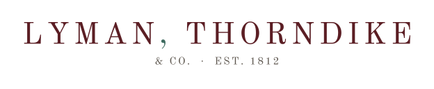

*Kept in good order.*

Lyman, Thorndike & Co. is a Boston investment bank and trust company. The house began as a Salem merchant's credit business and became a partnership in 1812, when the Thorndike and Lyman families joined their firms. It moved to State Street in the 1840s and has kept its accounts there since.

This organisation holds the work of the firm's technology teams.

## Markets technology

| | |
| --- | --- |
| Trading and booking | `trade-booking`, `position-keeper`, `trader-ui` |
| Electronic trading | `fix-gateway`, `order-router`, `algo-engine`, `rfq-gateway`, `market-maker` |
| Pricing and market data | `pricing-lib`, `market-data`, `kdb-tick`, `reference-data` |
| Risk | `market-risk`, `credit-risk` |

## Clients, financial crime and payments

| | |
| --- | --- |
| Onboarding and KYC | `client-onboarding`, `kyc-service`, `fenergo-config` |
| Financial crime | `sanctions-screening`, `aml-monitoring`, `actimize-policies` |
| Payments | `payments-gateway` |

## Operations and finance

| | |
| --- | --- |
| Post-trade | `trade-confirmations`, `settlements`, `collateral` |
| Reconciliations and control | `reconciliations`, `duco-recs`, `product-control`, `reg-reporting` |
| Trading platform | `murex-customizations` |

## Digital

| | |
| --- | --- |
| Public and client sites | `www`, `client-portal`, `research-portal` |
| Design system | `design-system` |

## Platform

| | |
| --- | --- |
| Infrastructure | `terraform-modules`, `k8s-platform`, `nats-server` |
| Delivery | `ci-templates`, `platform-tools` |
| Agent skills | `claude-plugins`, `copilot-skills`, `agent-skills` |

Questions about any of this go to Platform Engineering.

---

Lyman, Thorndike & Co. is a fictional firm. This organisation is a demonstration estate; its repositories are not working software, and nothing here refers to any real person or firm.
